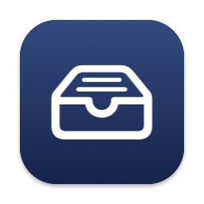

# DockShelf

Shelves for files and screenshots right next to the macOS Dock, in Liquid Glass that matches it.

**[Download the latest version](https://github.com/maxxerzy/dockshelf-releases/releases/latest)** — `DockShelf-<version>.dmg` (drag DockShelf onto Applications) or the `.pkg` installer. Apple Silicon and Intel, macOS 26 or later.

## What it does

- **Two shelves beside the Dock** in Liquid Glass that matches it — left and right of a bottom Dock, below and above a side Dock, following the Dock across displays and while you resize it.
- **You choose what each side shows:** a file shelf you drop files onto, Screenshots & Downloads, Screenshots, Downloads, the Desktop, a folder of your choice, or your clipboard history.
- **Right-click fan** with AirDrop in the middle, Quick Look, copy, copy text, Finder, convert and more; keyboard mode (⌃⌥⌘J) and customizable shortcuts.
- **Convert on the spot, with a progress ring:** videos to MP4 (H.264, plays everywhere) or MOV, a smaller 720p copy, a GIF or just the audio; audio to M4A, WAV or AIFF; HEIC and other images to JPEG, PNG, HEIC, TIFF or PDF; PDF pages to PNG or text, compress PDF; Word, RTF and text documents to PDF, Word, RTF or text.
- **Find screenshots by their text** — on-device text recognition and Apple Intelligence summaries, optionally in Spotlight.
- **Private:** everything stays on your Mac; the only network request is the update check on GitHub. German and English.

## First launch

DockShelf isn't notarized by Apple, so macOS blocks the very first launch:

1. Open DockShelf and click **Done** in the warning.
2. Open **System Settings → Privacy & Security**, scroll down and click **Open Anyway** next to DockShelf.
3. When asked, allow DockShelf under **Accessibility** — it only reads the Dock's position and size and whether the front window is in full screen.

Opening the disk image (or running the installer) first shows the [terms of use and privacy notice](TERMS-AND-PRIVACY.md); DockShelf installs only once you agree.

## Privacy

Everything stays on your Mac: no account, no analytics, no ads, no developer servers. Text recognition in screenshots runs on the device and can be turned off; the optional clipboard history lives in memory only and skips passwords marked confidential. The only network connection is the daily update check against this repository on GitHub (your IP address and the DockShelf version reach GitHub), which you can switch off under **Settings → Updates**. Full text: **[TERMS-AND-PRIVACY.md](TERMS-AND-PRIVACY.md)** (Deutsch & English).

## Updates

DockShelf checks this repository once a day and installs new versions quietly on the next quit. Where it can't (installed with the `.pkg`), its menu-bar icon gets a blue dot and the menu offers **Update to DockShelf …** — one click installs it. You can also use **Check for Updates…** in the menu at any time, or turn automatic checks off in Settings.

---

**Deutsch:** Neueste Version oben herunterladen. Beim ersten Start blockiert macOS die App: Warnung mit „Fertig“ schließen, dann *Systemeinstellungen → Datenschutz & Sicherheit* → bei DockShelf **„Dennoch öffnen“**. Bedienungshilfen erlauben, wenn gefragt. Beim Öffnen des Images bzw. im Installer erscheinen zuerst die [Nutzungsbedingungen und Datenschutzhinweise](TERMS-AND-PRIVACY.md), die du akzeptieren musst. Alles bleibt auf deinem Mac; DockShelf fragt nur einmal täglich GitHub nach Updates (abschaltbar in den Einstellungen). Updates kommen danach automatisch, sonst blauer Punkt am Menüleisten-Symbol → „Update to DockShelf …“.

*This repository only hosts releases and the update feed (`appcast.xml`).*
